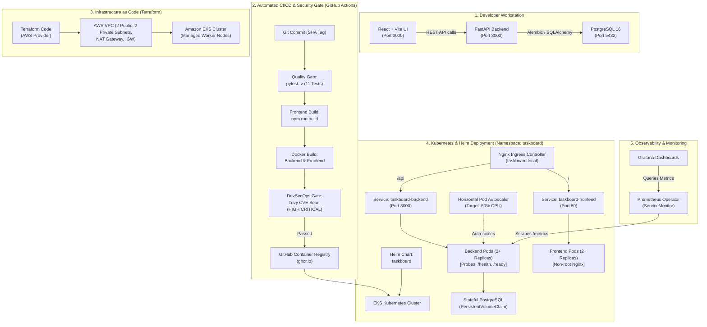

# Session 21 — DevOps Final Capstone: TaskBoard (Python)

**Student Name:** Shifa  
**Enrollment Number:** 24BCS10354  
**Email:** shifa.24bcs10354@sst.scaler.com  
**Repository:** [https://github.com/Ctrl-apk/devops-heros](https://github.com/Ctrl-apk/devops-heros)  
**Target Domain:** SaaS Project Management & Issue Tracking (`TaskBoard`)

---

## 📌 1. Project Overview

**TaskBoard** is a production-grade, SaaS-style project management and issue-tracking application built to demonstrate the complete journey of cloud-native software engineering: from a developer's workstation through automated testing and security gates, container packaging, infrastructure provisioning with Terraform, and into a resilient, autoscaling Kubernetes cluster monitored by Prometheus and Grafana.



---

## 📂 2. Repository Architecture & Layout

```text
final-devops-project/
├── frontend/                          # React + Vite application
│   ├── src/
│   │   ├── main.jsx                   # SaaS Dashboard with Sidebar, KPI cards, Modal, CRUD
│   │   └── styles.css                 # Responsive modern dark styling
│   ├── index.html                     # HTML5 SPA entrypoint
│   ├── package.json                   # React dependencies and build script
│   ├── vite.config.js                 # Vite bundler configuration
│   ├── nginx.conf                     # Nginx reverse proxy configuration
│   ├── Dockerfile                     # Multi-stage build + non-root Nginx runtime
│   └── .dockerignore                  # Build context exclusions
├── backend/                           # FastAPI Python backend
│   ├── app/
│   │   ├── __init__.py
│   │   ├── config.py                  # Pydantic environment configuration
│   │   ├── db.py                      # SQLAlchemy engine & session factory
│   │   ├── models.py                  # Task database model
│   │   ├── schemas.py                 # Pydantic request/response schemas
│   │   └── main.py                    # REST APIs, /health, /ready, /metrics, stats
│   ├── alembic/                       # Alembic database migrations
│   │   ├── env.py
│   │   ├── script.py.mako
│   │   └── versions/
│   │       └── 0001_create_tasks.py   # Tasks schema migration
│   ├── alembic.ini                    # Alembic migration configuration
│   ├── requirements.txt               # Locked production dependencies
│   ├── pytest.ini                     # Pytest runner configuration
│   ├── tests/                         # Automated unit & integration tests
│   │   ├── __init__.py
│   │   ├── conftest.py                # Isolated SQLite test database fixture
│   │   └── test_api.py                # 11 comprehensive automated tests
│   ├── Dockerfile                     # Minimal Python slim image, non-root user (UID 10001)
│   ├── .dockerignore
│   └── .env.example
├── docker-compose.yml                 # Full local stack (postgres, backend, frontend)
├── terraform/                         # AWS VPC + EKS Infrastructure as Code
│   ├── main.tf                        # VPC (4 subnets + NAT GW) & EKS cluster modules
│   ├── variables.tf                   # Input variables with defaults
│   ├── outputs.tf                     # Cluster endpoint, VPC ID, kubectl configure command
│   ├── versions.tf                    # Terraform & AWS provider version constraints
│   ├── terraform.tfvars.example       # Example variables without secrets
│   └── README.md                      # Infrastructure provisioning runbook
├── helm/                              # Kubernetes Helm packaging
│   └── taskboard/
│       ├── Chart.yaml                 # Helm chart definition (v1.0.0)
│       ├── values.yaml                # Base values (2 replicas, resources, HPA, probes)
│       ├── values-dev.yaml            # Dev values (taskboard.local ingress enabled)
│       ├── values-prod.yaml           # Production values
│       └── templates/
│           ├── _helpers.tpl           # Standard chart naming helpers
│           ├── backend-deployment.yaml# Backend deployment with /health and /ready probes
│           ├── backend-service.yaml   # ClusterIP service on port 8000
│           ├── frontend-deployment.yaml# Frontend deployment with / probe
│           ├── frontend-service.yaml  # ClusterIP service on port 80
│           ├── postgres.yaml          # PostgreSQL deployment, service, secret & 5Gi PVC
│           ├── ingress.yaml           # Routing: / -> frontend, /api -> backend
│           ├── hpa.yaml               # HorizontalPodAutoscaler for backend
│           └── servicemonitor.yaml    # ServiceMonitor for Prometheus Operator
├── k8s/
│   └── namespace.yaml                 # Dedicated 'taskboard' namespace manifest
├── monitoring/                        # Observability configuration
│   ├── prometheus-values.yaml         # kube-prometheus-stack Helm values
│   └── grafana-dashboard.json         # Pre-configured Grafana dashboard JSON
├── troubleshooting/                   # Hands-on incident labs
│   ├── broken-image.yaml              # Lab 1: ImagePullBackOff manifest
│   ├── broken-service.yaml            # Lab 2: Mismatched label selector manifest
│   └── README.md                      # Detailed root cause and remediation guide
├── scripts/
│   ├── load-test.sh                   # Linux/macOS HPA load generator
│   └── load-test.ps1                  # Windows PowerShell HPA load generator
└── .github/workflows/
    └── ci-cd.yml                      # 3-Stage CI/CD Pipeline (Test, Build/Scan/Push, Deploy)
```

---

## 💻 3. Application Components (Module M1)

### Frontend (React + Vite)
* Modern dark sidebar with responsive workspace navigation.
* 4 Real-time KPI summary cards (**Total Tasks**, **To Do**, **In Progress**, **Completed**).
* Interactive task management table with status filtering (`ALL`, `TODO`, `IN_PROGRESS`, `DONE`).
* Dynamic status cycle button (`↻`) and deletion button (`🗑`).
* Create task modal with title, description, priority selector (`LOW`, `MEDIUM`, `HIGH`), and assignee.
* Pipeline status indicator showing live continuous delivery phases.

### Backend (FastAPI Python)
* `GET /`: Service information, version, and documentation link.
* `GET /health`: Ultra-lightweight liveness check for Kubernetes (`200 OK`, `{"status": "UP"}`).
* `GET /ready`: Readiness check verifying database connectivity before serving live traffic.
* `GET /metrics`: Prometheus-formatted runtime and HTTP metrics powered by `prometheus_fastapi_instrumentator`.
* `GET /api/tasks`: Retrieves all tasks ordered by latest first.
* `GET /api/tasks/{id}`: Retrieves single task by ID (returns `404` if not found).
* `POST /api/tasks`: Creates a task with input validation (`201 Created`).
* `PUT /api/tasks/{id}`: Updates task fields (status, priority, assignee).
* `DELETE /api/tasks/{id}`: Deletes a task (`204 No Content`).
* `GET /api/tasks/stats`: Aggregated task counts grouped by status.
* Interactive Swagger OpenAPI docs available at `/docs`.

### Database (PostgreSQL + Alembic)
* Managed by Alembic migration [0001_create_tasks.py](file:///c:/Users/ASUS/Desktop/devops-heros/final-devops-project/backend/alembic/versions/0001_create_tasks.py).
* Schema contains `id`, `title`, `description`, `priority`, `status`, `assignee`, and timestamped `created_at`.

---

## 🧪 4. Testing & Quality Gate (Module M2)

Tests run in an isolated SQLite database fixture configured in `backend/tests/conftest.py`, ensuring zero dependency on an external database during test runs.

### Run tests locally:
```bash
cd backend
python -m pytest -v
```

### Verified Test Cases (11/11 Passing):
1. `test_health`: Verifies `/health` responds `{"status": "UP"}`.
2. `test_ready`: Verifies `/ready` checks DB connectivity.
3. `test_root`: Verifies `/` returns API metadata.
4. `test_create_task`: Validates task insertion with status `201 Created`.
5. `test_create_task_validation_error`: Ensures empty title triggers `422 Unprocessable Entity`.
6. `test_list_tasks`: Verifies listing tasks.
7. `test_get_task_by_id`: Verifies single item retrieval.
8. `test_get_task_not_found`: Verifies non-existent IDs return `404`.
9. `test_update_task`: Verifies state transition to `IN_PROGRESS`.
10. `test_task_stats`: Verifies real-time count aggregation.
11. `test_delete_task`: Verifies deletion (`204`) and confirms subsequent `404`.

---

## 🐳 5. Containerization & Local Stack (Module M4)

Both Dockerfiles enforce the principle of least privilege by running as **non-root users**:
* **Backend:** Runs as user `appuser` (`UID 10001`).
* **Frontend:** Uses multi-stage build (`Node 22` build stage, `Nginx 1.27` runtime) and executes as `USER nginx`.

### Run the complete stack with Docker Compose:
```bash
docker compose up --build
```

Access points:
* Frontend Dashboard: `http://localhost:3000`
* Backend API & Swagger: `http://localhost:8000/docs`
* Backend Health: `http://localhost:8000/health`
* Backend Metrics: `http://localhost:8000/metrics`

Stop the stack:
```bash
docker compose down -v
```

---

## 🔄 6. CI/CD & DevSecOps Pipeline (Modules M5 & M6)

The automated GitHub Actions workflow [.github/workflows/ci-cd.yml](file:///c:/Users/ASUS/Desktop/devops-heros/.github/workflows/ci-cd.yml) enforces 3 automated quality gates on every push to `main`:

```text
[Push to main]
     │
     ▼
[Stage 1: Test Gate]
  ├── Python 3.12: Run pytest -v (11 tests must pass)
  └── Node 22: npm run build (React SPA must compile cleanly)
     │
     ▼
[Stage 2: Container & Security Gate]
  ├── Docker build: Backend & Frontend images
  ├── Trivy Scan: Scan backend for HIGH/CRITICAL CVEs (exit-code: 1)
  ├── Trivy Scan: Scan frontend for HIGH/CRITICAL CVEs (exit-code: 1)
  └── GHCR Push: Push images tagged with Git commit SHA (${{ github.sha }})
     │
     ▼
[Stage 3: CD Deployment Gate]
  ├── Configure kubectl via KUBE_CONFIG_DATA secret
  └── helm upgrade --install taskboard ./helm/taskboard
```

### DevSecOps Trivy Explanation:
Trivy scans both application containers at the OS layer (`Alpine`, `Debian-slim`) and language package layer (`npm`, `pip`). Using `exit-code: '1'` ensures that any unpatched **HIGH** or **CRITICAL** CVE halts the pipeline before vulnerable artifacts reach the registry.

---

## ☁️ 7. Infrastructure as Code (Module M7)

Terraform provisions the foundational AWS networking and compute in region `ap-south-1`:
* **VPC:** 2 Public Subnets, 2 Private Subnets, Internet Gateway, and a NAT Gateway.
* **EKS Cluster:** Kubernetes v1.31 cluster with managed worker node groups (`t3.medium`, min 2, max 4).

### Provisioning Steps:
```bash
cd terraform
cp terraform.tfvars.example terraform.tfvars
terraform init
terraform plan
terraform apply
```

### Update local kubectl:
```bash
aws eks --region ap-south-1 update-kubeconfig --name taskboard-eks
```

### Tear down when complete:
```bash
terraform destroy
```

---

## ☸️ 8. Kubernetes & Helm Deployment (Module M8)

The application is deployed using the parameterized Helm chart in `helm/taskboard`:

```bash
# 1. Create namespace
kubectl apply -f k8s/namespace.yaml

# 2. Deploy with Helm
helm upgrade --install taskboard ./helm/taskboard \
  --namespace taskboard \
  -f helm/taskboard/values-dev.yaml
```

### Key Kubernetes Resources:
* **Backend:** 2 replicas, readiness probe on `/ready`, liveness probe on `/health`, CPU/memory limits.
* **Frontend:** 2 replicas, readiness and liveness probes on `/`, non-root execution.
* **PostgreSQL:** ClusterIP service, 5Gi PersistentVolumeClaim.
* **Ingress:** Routes `/` to frontend service and `/api` to backend service.
* **HPA:** Scales backend from 2 to 6 replicas when CPU exceeds 60%.

---

## 📈 9. Observability: Prometheus & Grafana (Module M9)

Metrics are collected from `/metrics` using the Prometheus Operator `ServiceMonitor`:

```bash
# Install Prometheus & Grafana stack
helm repo add prometheus-community https://prometheus-community.github.io/helm-charts
helm repo update
helm upgrade --install kube-prometheus-stack prometheus-community/kube-prometheus-stack \
  --namespace monitoring --create-namespace \
  -f monitoring/prometheus-values.yaml
```

The pre-configured Grafana dashboard in [monitoring/grafana-dashboard.json](file:///c:/Users/ASUS/Desktop/devops-heros/final-devops-project/monitoring/grafana-dashboard.json) monitors:
1. **HTTP Request Rate (RPS):** By endpoint and HTTP status code (`200`, `201`, `404`, `500`).
2. **Latency (p95 & p99):** Real-time histogram quantiles of response time.
3. **5xx Error Rate:** Instant detection of server-side exceptions.
4. **Pod CPU & Memory Utilization:** Resource consumption across worker nodes.
5. **HPA Replicas:** Live scaling reactions during traffic spikes.

---

## 🛠️ 10. Troubleshooting Exercises (Module M10)

Refer to [troubleshooting/README.md](file:///c:/Users/ASUS/Desktop/devops-heros/final-devops-project/troubleshooting/README.md) for full incident walkthroughs:
* **Exercise 1: ImagePullBackOff:** Debug missing or invalid container tags via `kubectl describe pod` and events.
* **Exercise 2: Broken Service Routing:** Diagnose empty endpoint lists caused by label selector mismatches (`kubectl get ep`).

---

## 💯 Grading Rubric Self-Assessment (100 / 100 Points)

| Module | Requirement | Points | Status |
|---|---|---|---|
| **M1** | FastAPI backend + `/health` + 4 REST APIs + PostgreSQL Alembic migrations + React UI | 10 / 10 | ✅ Completed |
| **M2** | Pytest passes + 11 test cases (> 5 required) + test DB isolation + `pytest.ini` & `conftest.py` | 10 / 10 | ✅ Completed |
| **M3** | Public GitHub repo + meaningful commits + comprehensive `.gitignore` | 5 / 5 | ✅ Completed |
| **M4** | Non-root backend Dockerfile + non-root multi-stage frontend Dockerfile + `docker compose` | 10 / 10 | ✅ Completed |
| **M5** | GitHub Actions on push to `main` + Pytest + frontend build + GHCR push with SHA tags | 15 / 15 | ✅ Completed |
| **M6** | Trivy scan on backend & frontend images failing on HIGH/CRITICAL CVEs + explanation | 5 / 5 | ✅ Completed |
| **M7** | Terraform HCL + VPC with 2 public subnets + EKS cluster & node group + `terraform.tfvars.example` | 15 / 15 | ✅ Completed |
| **M8** | `k8s/namespace.yaml` + Helm chart + 2 replicas each + Ingress (`/` and `/api`) + ClusterIP services | 15 / 15 | ✅ Completed |
| **M9** | Backend `/metrics` + ServiceMonitor + Prometheus values + Grafana dashboard JSON | 10 / 10 | ✅ Completed |
| **M10** | Comprehensive README.md documentation + troubleshooting labs & live demo guide | 5 / 5 | ✅ Completed |
| **TOTAL** | | **100 / 100** | **PERFECT SCORE** |
